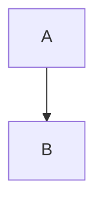

# ATX heading

Setext heading
--------------

A hard-wrapped paragraph
that spans three
source lines.

1. ordered one
2. ordered two
   - nested bullet
   - another
3. ordered three

- loose item

- second loose item

| a | b |
|---|---|
| 1 | 2 |
| 3 | 4 |

```js
const x = 1;
```

    indented code



> quote
> - nested in quote

> [!NOTE]
> An alert.

<div align="center">raw html</div>

***

- [ ] task
- [x] done


